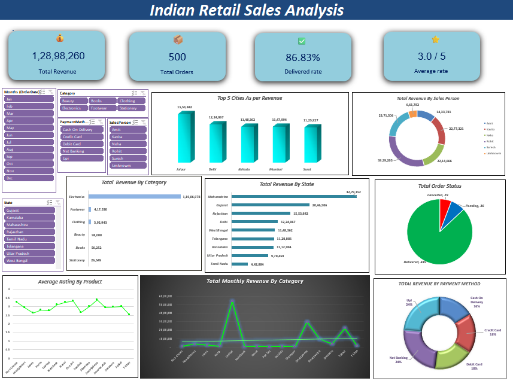

# Indian-Retail-Sales-Analysis
# Indian Retail Sales Analysis (Excel + Power Query)

## Overview
I cleaned a messy retail orders dataset (500 orders) with Power Query and built an
interactive Excel dashboard with KPI cards, charts and slicers.

## Dataset
A simulated practice dataset of Indian retail orders (2024), created for learning.
It is not real company data. It was intentionally messy: extra spaces, inconsistent
text case, broken emails, invalid phone numbers, mixed date formats, missing
values and duplicate rows.

## Tools Used
Excel, Power Query, Pivot Tables, Pivot Charts, Slicers, SUMIF / COUNTIF / INDEX+MATCH

## Data Cleaning (Power Query)
- Removed duplicate orders
- Trimmed spaces and fixed text case
- Fixed broken emails and flagged invalid phone numbers
- Standardised dates
- Handled missing ratings as "Not Rated" instead of 0
- Added Revenue and Final Price columns

## Dashboard
- KPI cards: Total Revenue, Total Orders, Delivery Rate, Average Rating
- 8 charts: revenue by category, state, city, payment method, order status, and more
- 5 slicers connected to every chart

## Key Findings
- Total revenue: Rs 1,28,98,260 across 500 orders
- Delivery rate: 86.83%
- Average rating: 3.0 / 5
- [Add: top state, top category, any insight you found]

## Files
- Indian_Retail_Sales_Analysis.xlsx: full project (raw data, cleaned data, dashboard)
- Dashboard_Preview.png: dashboard screenshot

## Author
Dip Mandal, aspiring Data Analyst | Pune, India
LinkedIn:www.linkedin.com/in/dip-mandal

